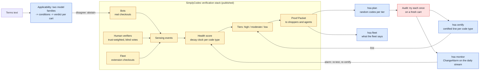
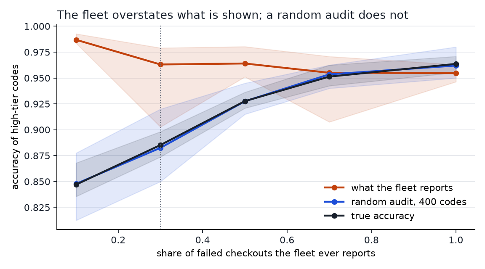
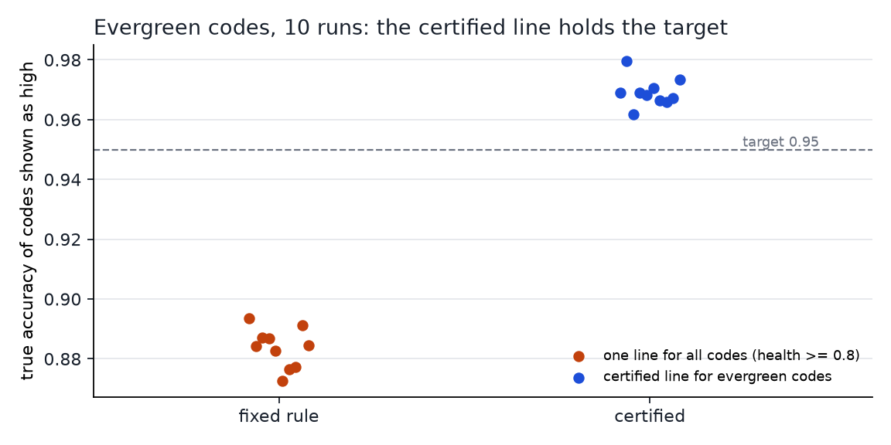
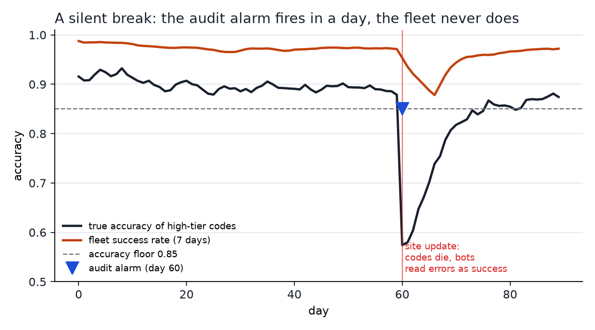
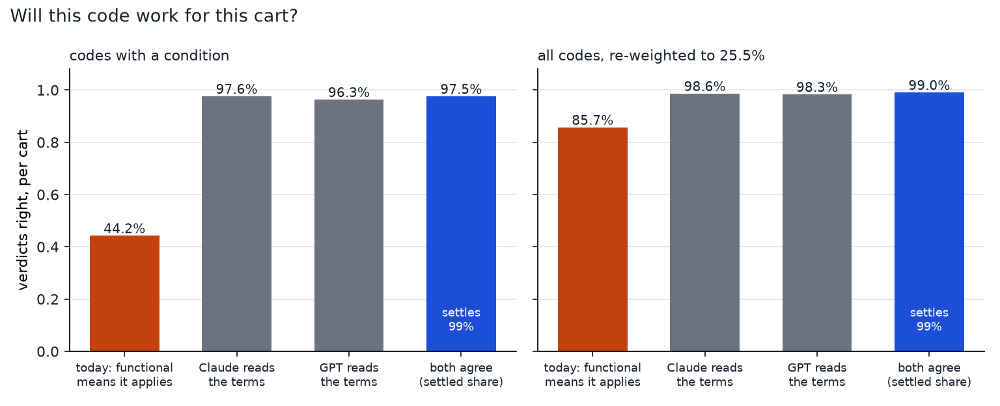

# health-score-audit

**A coupon code's health score says it works. How do you know the score is right, today, for this cart?**

SimplyCodes publishes how it adjudicates a coupon code: bots run real checkouts, trust-weighted human verifiers vote, extension users' real checkouts feed back (the fleet), and a health score with a decay clock per code type turns that evidence into confidence tiers ([Anatomy of a Verdict](https://product.ai/research/anatomy-of-a-verdict/), March 2026). This repository is an audit layer for a system built that way. It reads the published Proof Packet format, and it answers four questions with numbers:

| | Question | Answer here |
|---|---|---|
| 1 | Does the fleet's success rate measure the accuracy of what is shown? | No: it reads **96.3%** where the truth is **88.5%**. A random audit of 400 shown codes reads **88.2%**, and its interval covers the truth in 10 of 10 runs. |
| 2 | Where should the "high confidence" line sit? | One line for all codes holds **88.4%** on evergreen codes. A line certified per code type with verdict-gate holds **96.9%**, and its lower bound clears the 95% target. |
| 3 | A site update kills codes and the bots misread the new error page. Who notices? | A restarting audit alarm, in **1.6 days** on average (20 of 20 breaks, 0 false alarms in 20 clean runs). An all-time audit test: never. The fleet: once in 20. |
| 4 | Will this code work for **this cart**? | For codes with a condition, "functional means it applies" is right for **44%** of carts. Reading the fine print with two model families and settling only when they agree: **97.5%** right on 98.7% of carts, the rest sent to a bot. |

## Where the audit sits



Yellow: the published stack. Blue: this repository. Red: the audit itself (a robot or a trained verifier trying a randomly chosen code).

The world is a simulator calibrated to SimplyCodes' own published figures (code lifetimes from 23,107 codes, the 25.5% share of codes with conditions, 98% verifier accuracy, and more); [CALIBRATION.md](CALIBRATION.md) gives the source of every number and marks every assumption. The audit tools are built on [verdict-gate](https://github.com/vahit19/verdict-gate) and need only confidences and audited outcomes, so they run unchanged on real Proof Packets.

## 1. The fleet overstates what is shown



The fleet only sees codes it was shown, and it sees a success whenever a shopper checks out but a failure only when the failure is reported. When 30% of failures reach it, the fleet's success rate for high-tier codes is 96.3% while the true accuracy is 88.5% (10 runs). A random audit, 400 shown codes each tried once on a fresh cart, reads 88.2%, and its 95% one-sided bounds cover the truth in 10 of 10 runs. The gap closes once about 70% of failures reach the fleet (right of the chart); the audit covers the truth in 10 of 10 runs at every setting, without knowing how many do.

## 2. Certified tiers, one per code type



On a random audit of listed codes, `certify_by_group` (verdict-gate) picks, per code type, the loosest health line whose accuracy clears 95% with 95% confidence. For evergreen codes the line lands at about 0.98 and the codes above it are 96.9% accurate (10 runs, every run above 95%), against 88.4% under a single 0.8 line. Regular codes are not certified in any of the 10 runs: their high tier mixes dead codes with codes that only fit some carts, and no line separates them. That is question 4. Flash codes rarely build enough evidence to be shown before they die; they need a test at display time, not a tier.

## 3. A silent break, and who notices



On day 60 a site update kills 40% of live codes on 90% of merchants, and the bots there start reading the new error page as a success. The true accuracy of high-tier codes falls from 0.89 to about 0.56. With 25 random audits a day against a 0.85 floor:

| Monitor | Breaks caught (of 20) | Delay | False alarms (of 20 clean runs) |
|---|---|---|---|
| `ChangeAlarm` (this repo): restarts its evidence after good stretches | 20 | 1.6 days mean, 5 max | 0 |
| verdict-gate `AuditMonitor`: tests "below target since the start" | 0 | – | 0 |
| Fleet success rate over 7 days | 1 | – | 0 |

The all-time monitor's guarantee is right but it answers the wrong question for a system that runs for years: 60 good days leave its wealth far below one, and a sudden break has to climb out of that first. `ChangeAlarm` is a CUSUM-style e-detector: the same bets, floored at zero after each audit, averaged over five betting fractions; an alarm level of 10,000 bounds the average run length to a false alarm at 10,000 audits.

## 4. Will this code work for this cart?



The whitepaper names this as the next step: a bot can confirm that a code exists and functions, not that it applies to a given cart. Here the fine print is turned into machine-readable conditions (minimum spend that excluded items do not count toward, category scoping and exclusions, identity gates) and a plain rule engine applies them to each cart.

- **Data.** 167 promo codes drawn to match SimplyCodes' published counts, each with fine print written in dense retail legal style by `qwen/qwen3.8-flash`, full of numbers that are not conditions (free-shipping thresholds, savings caps, expiry dates, reward points). Ground truth is the conditions each code was drawn with; a check rejects any text that drops one. 20 realistic carts per code, 3,340 verdicts. ([data/](data/))
- **Reading.** `anthropic/claude-haiku-5.5` and `openai/gpt-5.6-luna` each return the conditions as JSON. Neither family reads text its own family wrote. When the two give the same verdict for a cart, the machine settles it; otherwise it abstains and the code goes to a bot checkout with that cart.

| Verdict per cart | Codes with a condition (1,980 verdicts) | All codes, re-weighted to the published 25.5% |
|---|---|---|
| Today: a functional code applies to every cart | **44.2%** right | 85.7% |
| Claude reads the terms | 97.6% | 98.6% |
| GPT reads the terms | 96.3% | 98.3% |
| Both agree, else abstain | settles 98.7%, **97.5%** right | settles 98.8%, 99.0% right |

Over all 3,340 verdicts the agreement gate settles 98.8% at 98.4% accuracy (at least 98.0% with 95% confidence) and sends 41 cart checks to a bot.

**The answer key needed an audit too.** Field by field, the models' excluded categories disagree with the truth on about 60% of codes. In 98 of Claude's 101 disagreements (99 of GPT's 105) the extra exclusion is written in the fine print: the generator added boilerplate exclusions ("clearance and final-sale items") despite being told not to, and the models read them correctly. Only 3 disagreements miss an exclusion that was there. The accuracies above are therefore lower bounds, and the episode is the point of the seat in miniature: a grade is only as good as the exam behind it.

**What this does not show.** The fine print is model-written, not scraped from retailers; real terms can be messier (brand lists, "select styles", app-only rules). Carts are simulated, and conditions the schema cannot express (specific SKUs, payment method, store card) are out of scope.

## Run it on Proof Packets

```bash
pip install -e .                       # numpy, scipy, verdict-gate
hsa fleet packets.jsonl                # what the fleet says per tier
hsa plan packets.jsonl --per-tier 400 --out audit.csv      # random codes to try once each
hsa certify audit_done.csv --target 0.95                   # one certified line per code type
hsa monitor audit_stream.csv --floor 0.85                  # first alarm, if any
```

`packets.jsonl` holds one Proof Packet per line, in the published shape (`code`, `merchant`, `verdict`, `confidence`, `evidence.fleet_signal`, `evidence.health.decay_rate`). `examples/cli_demo.py` runs all four commands on packets exported from the simulator: the fleet reads 98.1% for the high tier, the audit 89.6%; the certified evergreen line admits 83% of evergreen codes at 96.8% (at least 95.4%); the alarm fires on day 61, a day after the break.

## Reproduce

```bash
uv run python examples/run_all.py                          # questions 1-3, about a minute on CPU
uv run --extra figures python examples/make_figures.py
uv run python examples/cli_demo.py
uv run python examples/run_applicability.py              # question 4, offline from data/ (--fresh N regenerates via OpenRouter)
uv run --group dev pytest
```

## What this does not show

- The health score, the bot and verifier behavior, and the signal weights model the published architecture; they are not Product.ai's system. What the audit guarantees (the interval covers the truth, a certificate holds, the alarm's false-alarm bound) depends only on drawing the audit at random. How large the effects are (how far the fleet overstates, how many codes a line admits, how fast the alarm fires) depends on the assumptions listed in [CALIBRATION.md](CALIBRATION.md) and must be re-measured on real events.
- The fleet's share of reported failures is not published; the bias in question 1 is shown across 10–100%.
- One break scenario. Other failures (a spam wave, a verifier pool that drifts) are not simulated; the random audit is meant to cover what nobody listed, but only the scenario above is measured.

## License

MIT. Author: Vahit FERYAD.
